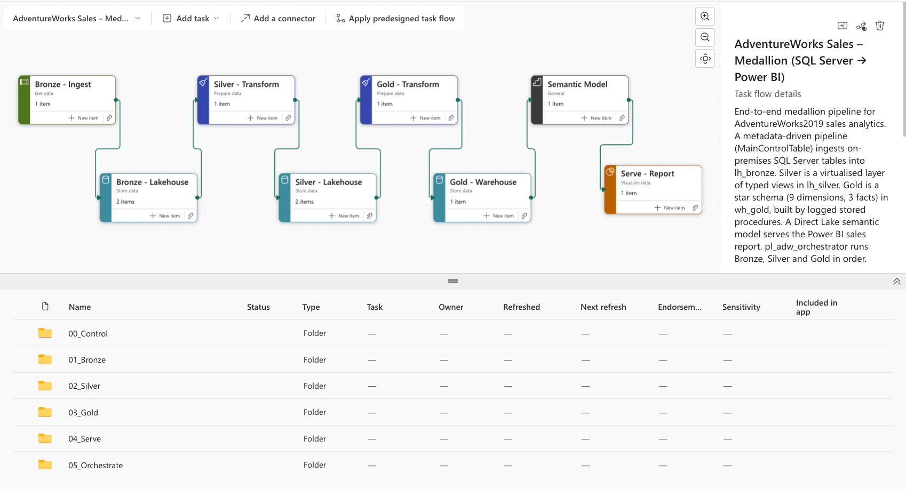
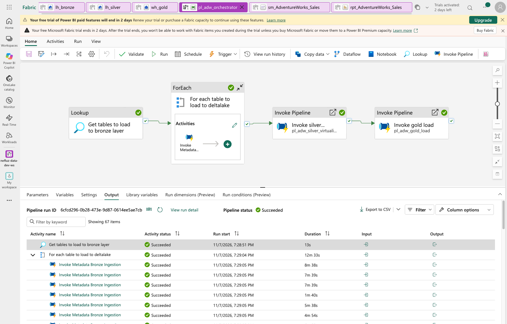
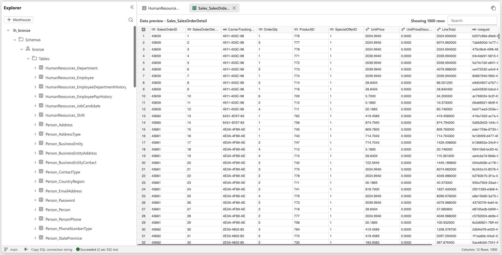
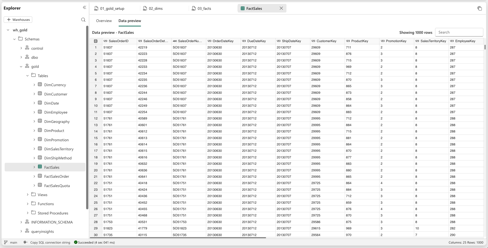
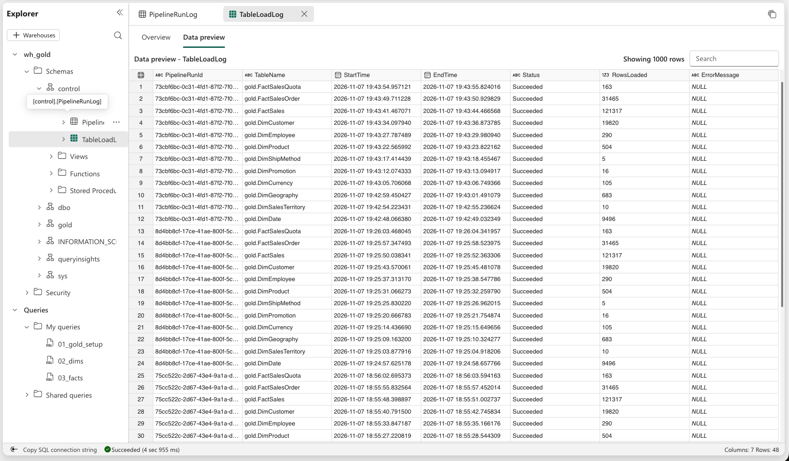
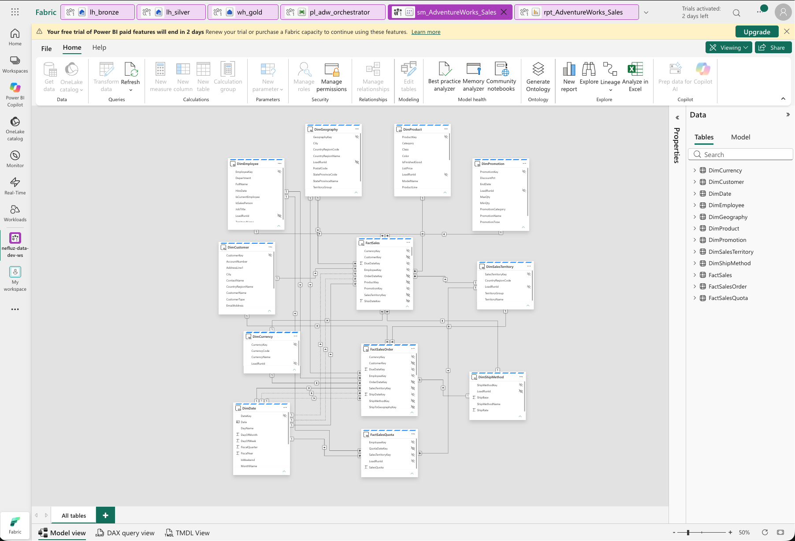
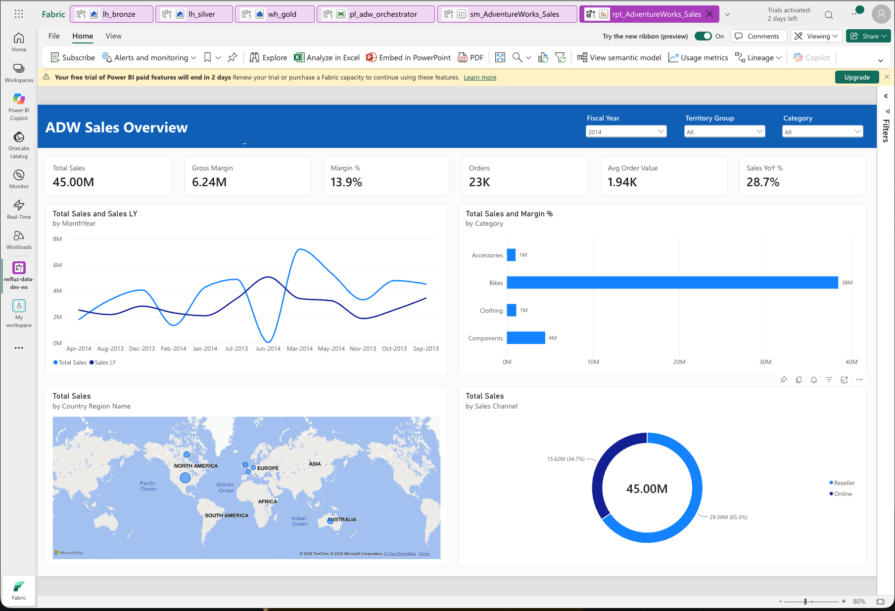

# AdventureWorks Sales – Microsoft Fabric Medallion

End-to-end Microsoft Fabric project: metadata-driven ingestion of **AdventureWorks2019** from an on-premises SQL Server into a **Bronze** lakehouse, a virtualised **Silver** layer of typed views, a **Gold** star schema built with logged T-SQL stored procedures, and a **Direct Lake** semantic model with a Power BI report.



---

## Architecture

```
On-prem SQL Server (AdventureWorks2019)
        │  pl_adw_bronze_ingestion   (Lookup → ForEach → Copy, metadata-driven)
        ▼
lh_bronze      Bronze  – raw Delta tables, one per source table
        │  pl_adw_silver_virtualization   (util.usp_CreateAllSilverViews)
        ▼
lh_silver      Silver  – typed views over Bronze (no data copied)
        │  pl_adw_gold_load   (Lookup → ForEach → gold.usp_Load_*)
        ▼
wh_gold        Gold    – star schema: 9 dimensions, 3 facts + ETL logs
        │  Direct Lake
        ▼
sm_AdventureWorks_Sales  →  rpt_AdventureWorks_Sales

pl_adw_orchestrator runs Bronze → Silver → Gold in order.
Metadata_WH holds the control table that drives every layer.
```

| Layer | Item | Purpose |
|---|---|---|
| Control | `Metadata_WH` | `metadata.MainControlTable` (what to load, per layer, in what order) and `metadata.AdventureWorks` (source column metadata) |
| Bronze | `lh_bronze` | Raw copy of the source, full load, Delta format |
| Silver | `lh_silver` | Views that cast every column to a Fabric-compatible type |
| Gold | `wh_gold` | Dimensional model for reporting, plus `control` logging |
| Serve | `sm_AdventureWorks_Sales`, `rpt_AdventureWorks_Sales` | Direct Lake semantic model and Power BI report |

---

## Key design decisions

**Metadata-driven.** One control table, `metadata.MainControlTable`, drives all three layers (`layer` = `bronze` / `silver` / `gold`). Adding a table means adding a row, not changing a pipeline.

**Bronze – unsupported types handled at source.** Delta has no type for `geography`, `hierarchyid`, `time` or `xml`. A generator (`sql/metadata/01_bronze_sourcequery_generator.sql`) writes an explicit `SELECT` into `sourcequery` that converts them to text on the SQL Server side.

**Silver – virtualised.** Views, not copies. `util.usp_CreateSilverView` generates each view from the source metadata and maps types for Fabric (e.g. `nvarchar(n)` → `varchar(2n)` for UTF-8, `money` → `decimal(19,4)`, `tinyint` → `smallint`, datetimes → `datetime2(6)`). The driver proc also reports metadata tables missing from Bronze.

**Gold – simple and safe.**
- Every table is fully rebuilt each run (`DELETE` + `INSERT` in one transaction) – correct for a full-load Bronze and fast at this volume.
- Dimension keys are the source IDs; `-1` = Unknown member so no fact row is ever dropped.
- `DimDate` has no `-1` row so Power BI time intelligence works (contiguous dates).
- Gross margin uses `ProductCostHistory` **as at the order date**, not today's cost.
- Grain check on `FactSales` rolls back the load if a duplicate line appears.

**Two-level logging.**
- `control.PipelineRunLog` – one row per pipeline run (`control.usp_LogPipelineRun`)
- `control.TableLoadLog` – one row per table per run (`control.usp_LogTableLoad`)
- If a table fails, every later table in the same run is logged as `Skipped`, so nothing loads on top of a broken dimension.
- Retry-safe: a retried table replaces its own earlier attempt instead of being skipped.
- The Silver step fails (not just prints) if any view fails to build, so Gold never loads from broken views.

---

## Gold model

| Dimensions | Facts |
|---|---|
| DimDate (fiscal year starts 1 July) | **FactSales** – order line: quantity, sales, discount, cost, margin |
| DimCustomer (Individual / Store) | **FactSalesOrder** – order header: tax, freight, days to ship |
| DimProduct | **FactSalesQuota** – salesperson quota per quarter |
| DimEmployee | |
| DimGeography, DimSalesTerritory | |
| DimPromotion, DimShipMethod, DimCurrency | |

**Semantic model:** Direct Lake on `wh_gold`; star relationships with OrderDate active and ShipDate/DueDate inactive (role-playing via `USERELATIONSHIP`); `DimDate` marked as date table; measures grouped in display folders – Sales, Orders, Channel, Time Intelligence, Customers, Product, Sales Team.

---

## Repository structure

```
README.md
docs/screenshots/        project screenshots
sql/
  metadata/              run in Metadata_WH
  silver/                run in lh_silver (SQL analytics endpoint)
  gold/                  run in wh_gold
fabric/                  written by Fabric Git integration – do not edit by hand
```

`fabric/` holds the item definitions (pipelines, warehouses, lakehouses, semantic model, report) synced from the workspace. `sql/` holds the same logic as runnable scripts in run order.

---

## Naming convention

| Prefix | Item | Example |
|---|---|---|
| `lh_` | Lakehouse | `lh_bronze` |
| `wh_` | Warehouse | `wh_gold` |
| `pl_adw_` | Data pipeline | `pl_adw_gold_load` |
| `sm_` | Semantic model | `sm_AdventureWorks_Sales` |
| `rpt_` | Report | `rpt_AdventureWorks_Sales` |
| `usp_` | Stored procedure | `gold.usp_Load_DimCustomer` |

---

## Screenshots

| | |
|---|---|
| Pipeline run |  |
| Bronze table |  |
| Gold tables |  |
| Control logs |  |
| Semantic model |  |
| Power BI Report |  |
